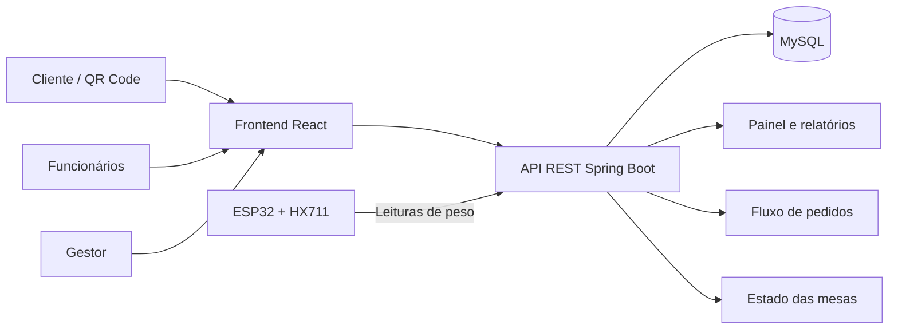
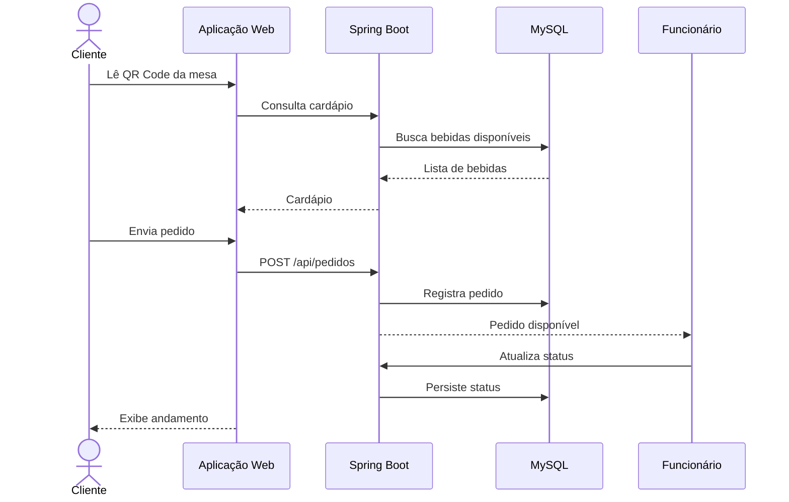
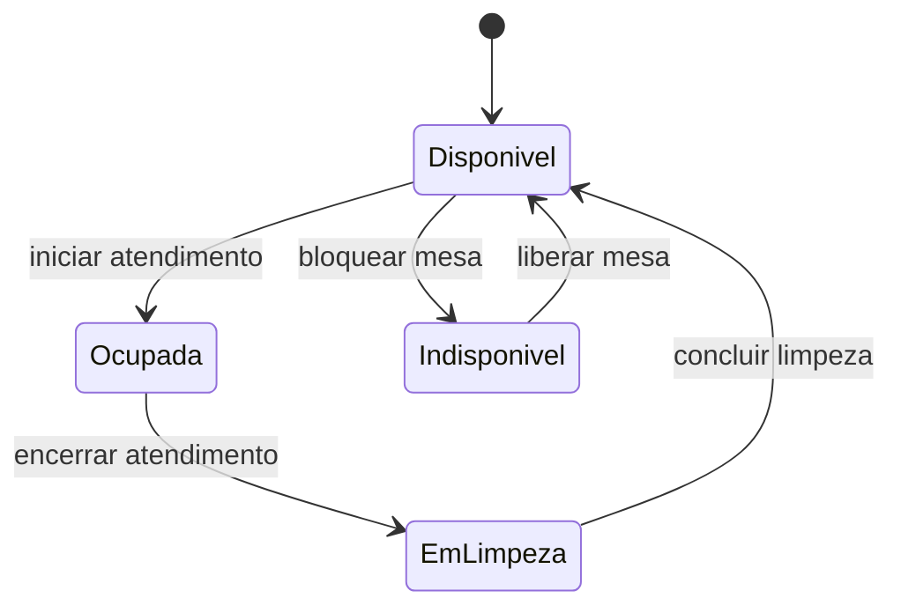

# Arquitetura e integração

## Visão geral

## Fluxo de pedido de bebida

## Ciclo de vida da mesa

## Fluxo do sensor

1. O ESP32 inicializa e conecta à rede.
2. O HX711 fornece a leitura da célula de carga.
3. O dispositivo aplica calibração e filtro de estabilidade.
4. O dispositivo envia peso, equipamento e instante da leitura.
5. A API valida e armazena a leitura.
6. O serviço calcula a variação entre leituras estáveis e registra uma estimativa.
7. O painel apresenta a estimativa com indicação de que não representa consumo individual confirmado.

## Separação de responsabilidades

- **Frontend:** interface e experiência de cliente, equipe e gestor.
- **Backend:** regras de negócio, autenticação, validação e API.
- **Banco:** persistência e integridade dos dados.
- **IoT:** aquisição e envio das leituras dos sensores.

## Segurança e confiabilidade

- Autenticação e autorização por perfil.
- Senhas armazenadas com hash seguro.
- Validação de dados recebidos pela API.
- Comunicação protegida em ambiente de produção.
- Registro de alterações relevantes.
- Tratamento de falhas de rede e leituras inválidas.
